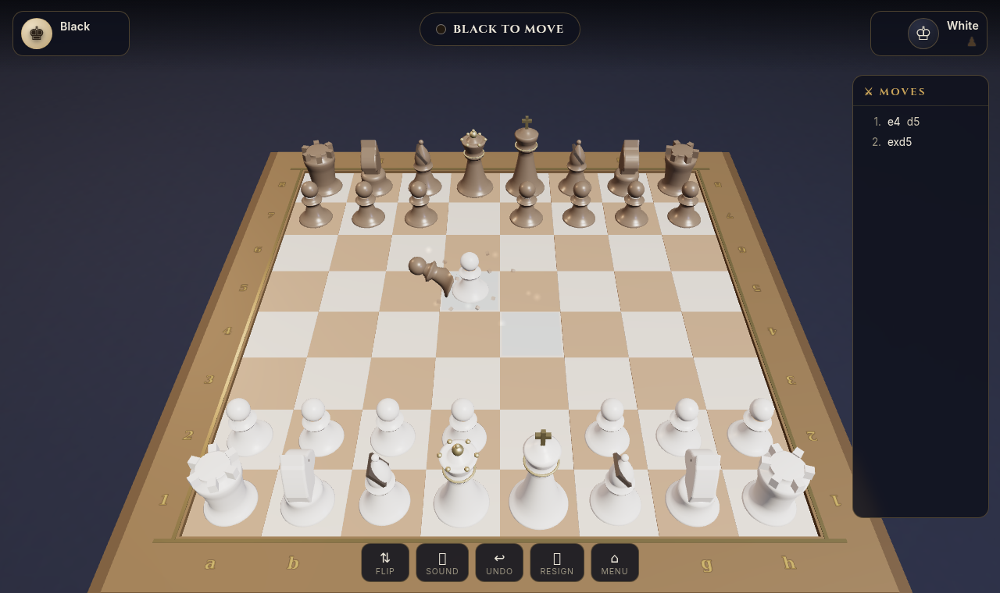

# ⚔️ Blade Chess 3D

A smooth 3D chess website with **real sculpted pieces** (King, Queen, Rook, Bishop, Knight, Pawns built as true 3D models), **silky move animations**, and **Harry-Potter-style sword duels** — when a piece captures another, both pieces draw their swords, the blades clash, the defender is disarmed, and the attacker cuts it in two.



## Play

- **🤖 Play vs Bot** — three difficulty levels: *Squire* (easy), *Knight* (medium), *King* (hard). Pick your side.
- **🛡️ Play with a Code** — create a room, share the 5-letter code (or invite link) with a friend, and duel online. Includes rematch (colors swap), resign, reconnect and refresh recovery.
- **👥 Local 2 Players** — pass & play on one screen.

## Controls

| Action | How |
|---|---|
| Move a piece | Click your piece, then click a highlighted square |
| Orbit camera | Drag |
| Zoom | Scroll / pinch |
| Flip camera | ⇅ button |
| Undo (bot / local) | ↩ button |
| Resign | 🏳 button |

Extras: move hints (dots = moves, red rings = captures), last-move highlight, pulsing check warning, captured-piece trays, move history in algebraic notation, promotion picker, synthesized sound effects (toggle with 🔊).

Add `?fx=low` to the URL for a lighter mode on weak devices (no shadows/dust). Add `?join=CODE` to jump straight into a room.

## Run it

Zero dependencies — plain Node.js:

```bash
node server.js          # → http://localhost:3000
PORT=8080 node server.js
```

To play a code game with a friend, keep the server reachable and share your URL + room code.

## Tech

- **Three.js (r128)** — procedural pieces: lathe-turned bodies, extruded knight heads, gold crown/cross details; ACES tone mapping, soft shadows, fog, dust motes.
- **Sword-duel captures** — the attacker closes in and draws its sword; the defender raises its own in guard. The blades **clash** (sparks, flash, camera shake), the defender's sword is **knocked flying**, and the attacker's blade sweeps through: the victim is duplicated and split with per-material **clipping planes**, the top half tumbling away with gravity while the bottom tips over.
- **chess.js** — full rule correctness (castling, en passant, promotion, threefold repetition, 50-move, stalemate…), on both client and server.
- **Bot engine** — negamax with alpha-beta, quiescence search and piece-square tables, running in a Web Worker so the UI never stutters.
- **Server** — zero-dependency Node `http` server: static files + room-code multiplayer API with server-side move validation, heartbeats, rematch and idle-room cleanup.
- **Sound** — all effects synthesized live with WebAudio (no audio files).

## Project layout

```
server.js               Node server (static + /api rooms)
public/
  index.html            UI shell (menu, HUD, modals)
  style.css             dark & gold theme
  js/
    scene.js            Three.js scene, pieces, animations, sword duels
    game.js             game logic, modes, HUD, online sync
    engine.js           bot (negamax + quiescence), worker-ready
    audio.js            WebAudio sound effects
  vendor/               three.min.js, chess.min.js
screenshots/            captured in-game shots
```
